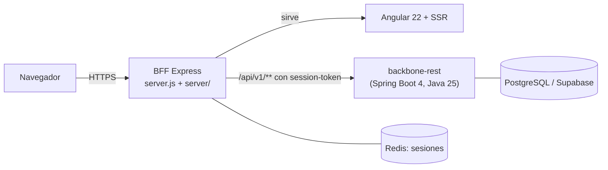

# Stratum

Interfaz de administración de **backbone-rest**: usuarios, roles, personas, contactos, aplicaciones, clientes gestionados,
auditoría y reportes de uso. Es una aplicación Angular 22 con un servidor Node (BFF, *backend for frontend*) que sirve la
aplicación y reenvía las llamadas al API.



## Requisitos

- Node 24 y pnpm 12 (`corepack enable`)
- Un backbone-rest accesible (`BACKBONE_BASE_URL`)
- Chrome, para las pruebas de Angular

## Primeros pasos

```bash
pnpm install
pnpm run dev            # compila en modo watch y arranca el BFF en https://localhost:4000
pnpm run start          # solo el servidor de desarrollo de Angular (:4200), sin BFF
```

## Scripts

| Script | Qué hace |
|--------|----------|
| `pnpm run lint` | ESLint: TypeScript, plantillas, accesibilidad y BFF |
| `pnpm run test:headless` | Pruebas de Angular con cobertura (mínimo 85 %) |
| `pnpm run test:server` | Pruebas del BFF con `node:test` (mínimo 85 %) |
| `pnpm run test:all` | Las dos anteriores |
| `pnpm run build:ssr` | Build de producción |
| `pnpm run serve:ssr` | Arranca el BFF con la aplicación compilada |

## Variables de entorno del BFF

| Variable | Por defecto | Para qué |
|----------|-------------|----------|
| `BACKBONE_BASE_URL` | `http://localhost:8443` | URL del API backbone-rest |
| `BACKBONE_CA_PATH` | vacía | CA que firmó el certificado de backbone; con ella el BFF **verifica** el certificado |
| `BACKBONE_TLS_SERVERNAME` | vacía | Nombre contra el que se verifica el certificado |
| `CORS_ORIGIN` | vacía | Orígenes permitidos (lista); en producción no admite `*` |
| `REDIS_URL` | `redis://localhost:6379` | Almacén de sesiones (sin Redis usa memoria) |
| `PORT`, `NODE_ENV`, `TRUST_PROXY`, `LOG_LEVEL` | ver `server/config/constants.js` | Puerto, entorno, saltos de proxy de confianza, nivel de log |

Detalle de despliegue y operación: `docs/09-guia-tecnica-docker.md` y `docs/10-guia-usuario-docker.md`. CI y calidad:
`docs/11-guia-tecnica-ci.md`. Guías funcionales por módulo: `docs/00-indice.md`.
