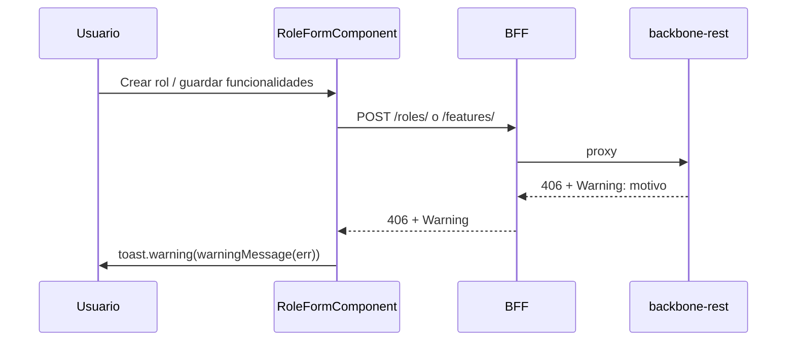

# Features — Fusionado en Roles

> ✅ **Implementado**, pero no como módulo independiente. El plan original proponía una pantalla `/features-mgmt` con su propio CRUD, separada de Roles. En la implementación real, la gestión de features se hizo **inline dentro de `role-form`**: cada rol lleva su propia lista editable de funcionalidades (agregar/editar/desactivar), que se envía junto con el rol al crear o actualizar.
>
> Ver [03 · Roles](./03-roles.md) para el detalle actual. Este documento se conserva solo por referencia histórica del contrato de `FeatureService` (que sigue existiendo y sin cambios: `getAll`, `getById`, `getByRole`, `create`, `update` en `src/app/core/services/feature.service.ts`) y de por qué no hay `DELETE` para features — la API no lo expone.

---

## Por qué se fusionó

El dashboard siempre documentó las features como algo "de cada rol" ("Aplicaciones, sus usuarios, roles y las features de cada rol"), y la API no tiene un endpoint para desvincular una feature de un rol sin pasar por el propio rol. Mantener una pantalla de catálogo global de features, separada de dónde se usan, agregaba un paso extra sin beneficio real — por eso `role-form` las gestiona directamente.

## Restricción de API (sigue vigente)

`DELETE /api/v1/features/{featureId}` no existe. Una feature ya persistida en un rol solo puede desactivarse, no eliminarse — si se elimina del array sin desactivar, la próxima carga del rol la trae de vuelta activa.

## Catálogo paginado (backbone T-79)

El catálogo ya no se lista completo: `GET /features/?q=&active=&page=&size=` (máx. 50) alimenta la vista de Features
y el selector "Reutilizar una funcionalidad existente" del formulario de rol (solo al crear; las features con `id`
se envían como referencia). `GET /features/{id}/roles` muestra qué roles y aplicaciones usan cada feature.
`GET /features/{includeInactive}` está deprecado.

## Aviso de funcionalidad duplicada

### Guía de usuario
Si al crear un rol (o al agregar una funcionalidad nueva editando un rol) la funcionalidad **ya existe**, el sistema no la crea y muestra un aviso amarillo con el motivo que informa el servicio (p. ej. «Feature already exists»). Al editar, el aviso indica además que el rol sí se guardó. Para reutilizarla, búscala en «Reutilizar una funcionalidad existente» y agrégala desde el catálogo.

### Guía técnica
El backend responde `406 Not Acceptable` y deja el motivo en la cabecera `Warning`; el BFF la reenvía (`server/shared/proxy.js`). `warningMessage(err)` (`src/app/shared/utils/warning.util.ts`) la extrae, quita el prefijo RFC 7234 y duplicados, y `RoleFormComponent` la muestra con `ToastService.warning`. Sin cabecera se conserva el error genérico.

