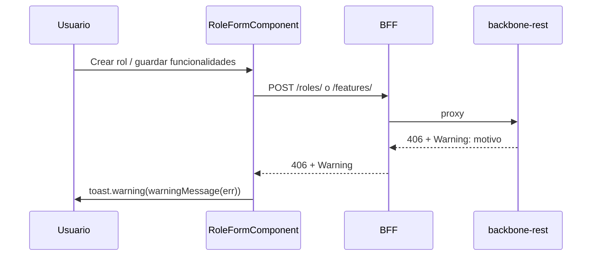
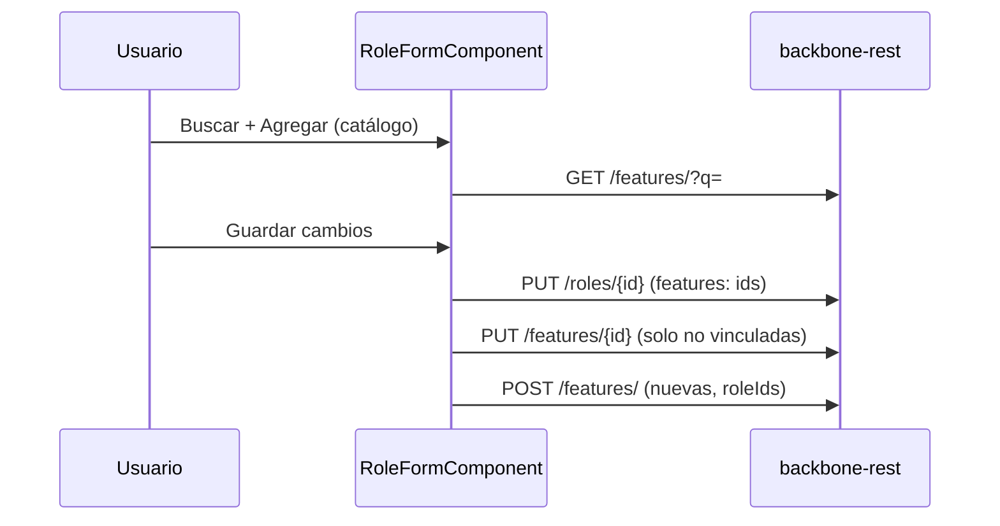
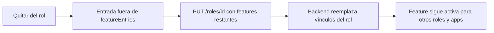

# Features — Fusionado en Roles

> ✅ **Implementado**, pero no como módulo independiente. El plan original proponía una pantalla `/features-mgmt` con su propio CRUD, separada de Roles. En la implementación real, la gestión de features se hizo **inline dentro de `role-form`**: cada rol lleva su propia lista editable de funcionalidades (agregar/editar/desactivar), que se envía junto con el rol al crear o actualizar.
>
> Ver [03 · Roles](./03-roles.md) para el detalle actual. Este documento se conserva solo por referencia histórica del contrato de `FeatureService` (que sigue existiendo y sin cambios: `getAll`, `getById`, `getByRole`, `create`, `update` en `src/app/core/services/feature.service.ts`) y de por qué no hay `DELETE` para features — la API no lo expone.

---

## Por qué se fusionó

El dashboard siempre documentó las features como algo "de cada rol" ("Aplicaciones, sus usuarios, roles y las features de cada rol"), y la API no tiene un endpoint para desvincular una feature de un rol sin pasar por el propio rol. Mantener una pantalla de catálogo global de features, separada de dónde se usan, agregaba un paso extra sin beneficio real — por eso `role-form` las gestiona directamente.

## Restricción de API (sigue vigente)

`DELETE /api/v1/features/{featureId}` no existe, y una feature es **compartida** por todos los roles y aplicaciones. Por eso, en el formulario de rol, quitar una funcionalidad solo la **desvincula de ese rol** (ver «Quitar una funcionalidad de un rol»); nunca se desactiva ni se elimina globalmente.

## Catálogo paginado (backbone T-79)

El catálogo ya no se lista completo: `GET /features/?q=&active=&page=&size=` (máx. 50) alimenta la vista de Features
y el selector "Reutilizar una funcionalidad existente" del formulario de rol (al crear y al editar; las features con `id`
se envían como referencia). `GET /features/{id}/roles` muestra qué roles y aplicaciones usan cada feature.
`GET /features/{includeInactive}` está deprecado.

## Aviso de funcionalidad duplicada

### Guía de usuario
Si al crear un rol (o al agregar una funcionalidad nueva editando un rol) la funcionalidad **ya existe**, el sistema no la crea y muestra un aviso amarillo con el motivo que informa el servicio (p. ej. «Feature already exists»). Al editar, el aviso indica además que el rol sí se guardó. Para reutilizarla, búscala en «Reutilizar una funcionalidad existente» y agrégala desde el catálogo.

### Guía técnica
El backend responde `406 Not Acceptable` y deja el motivo en la cabecera `Warning`; el BFF la reenvía (`server/shared/proxy.js`). `warningMessage(err)` (`src/app/shared/utils/warning.util.ts`) la extrae, quita el prefijo RFC 7234 y duplicados, y `RoleFormComponent` la muestra con `ToastService.warning`. Sin cabecera se conserva el error genérico.

## Reutilizar funcionalidades al editar un rol

### Guía de usuario
En «Editar rol» aparece el mismo cuadro «Reutilizar una funcionalidad existente»: escribe parte del nombre, pulsa **Buscar** y **Agregar** sobre la que quieras. La funcionalidad aparece en la lista (solo lectura, porque es compartida con otros roles) y queda asociada al rol al pulsar **Guardar cambios**. Si te equivocas antes de guardar, usa el icono de papelera para quitarla. Una funcionalidad ya guardada en el rol solo puede **desactivarse**. Si intentas crear una funcionalidad con un nombre que ya existe, verás un aviso indicándolo.

### Guía técnica
`PUT /roles/{id}` **reemplaza** el conjunto de funcionalidades del rol (`RoleFeatureLinkService.replaceRoleFeatures`), por lo que `RoleFormComponent` envía en `role.features` el `id` de todas las entradas con `backendId` (las cargadas y las del catálogo). Las entradas del catálogo llevan `linked: true`: no se editan y se omiten del `PUT /features/{id}`. Las nuevas siguen creándose con `POST /features/` y `roleIds: [roleId]`. Un duplicado sin cabecera `Warning` (406 en `/features`, 409 en `/roles`) se informa con `featureConflictMessage()`.

## Quitar una funcionalidad de un rol

### Guía de usuario
En «Editar rol», el icono de papelera («Quitar del rol») retira la funcionalidad **solo de ese rol**; las demás aplicaciones y roles que la usan no se ven afectados. El interruptor Activa/Inactiva de una funcionalidad existente es de solo lectura, porque es el estado global y no se cambia desde un rol. Los cambios se aplican al pulsar **Guardar cambios**.

### Guía técnica
`PUT /roles/{id}` reemplaza el conjunto de funcionalidades del rol, así que omitir una de `role.features` la desvincula solo de ese rol. `RoleFormComponent.removeFeature` ya no marca `active=false` ni dispara `PUT /features/{id}` con ese cambio: las entradas quitadas desaparecen de la lista y por tanto de la petición. Las entradas existentes se actualizan con su `active` original (nunca modificado desde el formulario).

