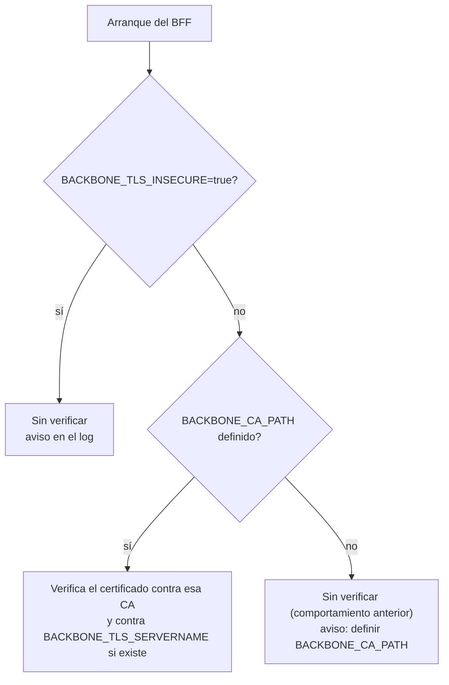
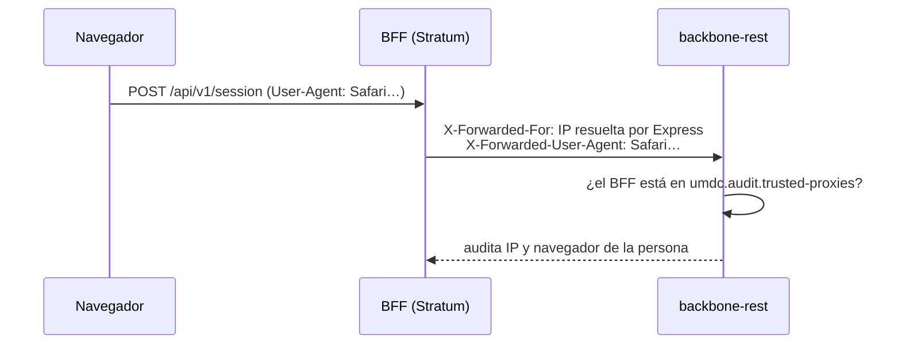

# Guía técnica — Despliegue con Docker

Stratum (Angular SSR + BFF Express) se empaqueta en una imagen Docker y se publica por **HTTPS en el puerto 443** bajo `https://stratum.umdc-qa.tst`.

## Archivos

| Archivo | Propósito |
|---|---|
| `Dockerfile` | Build multi-etapa: compila Angular (`ng build --configuration production`) y deja una imagen final solo con dependencias de producción, `server.js`, `server/` y `dist/`. |
| `docker-compose.yml` | Servicio `stratum` (BFF + SSR; Redis es externo, en la nube), puerto interno 7008 (sin publicar en el host), red compartida `nginx_umdc-net`. |
| `.dockerignore` | Excluye `node_modules`, `dist`, `.env`, `ssl/`, `.git`, docs, etc. del contexto de build. |

## Arquitectura

```
cliente ──https:443──▶ nginx-proxy (umdc-nginx) ──https──▶ contenedor stratum (node server.js, https :7008)
                                   ├─▶ REDIS_URL (Redis en la nube)
                                   └─▶ BACKBONE_BASE_URL (https, red nginx_umdc-net)
```

- El BFF **termina TLS por sí mismo** (`https.createServer` en `server.js`); no hay proxy delante dentro del compose.
- Dentro del contenedor escucha en `7008` y corre como usuario `node` (sin privilegios). **No publica puertos en el host**: el 443 externo lo atiende `nginx` (contenedor `umdc-nginx`), que resuelve `stratum.umdc-qa.tst` hacia `https://stratum:7008` por la red `nginx_umdc-net` (bloque `server_name stratum.umdc-qa.tst` en `nginx/config/default.conf`, rama `feat/stratum-server-name`). Al no publicar puertos tampoco choca con otros servicios del host.
- Las llaves TLS **no se incluyen en la imagen**: se montan en solo lectura desde `./ssl`.

## Prerrequisitos

1. Docker Engine con Compose v2.
2. Certificado y llave del dominio en `./ssl/` (ignorada por git):
   - `wildcard.umdc-qa.tst.crt`
   - `wildcard.umdc-qa.tst.key`

   El certificado wildcard cubre `stratum.umdc-qa.tst`.
3. DNS (o `/etc/hosts` en el cliente) que resuelva `stratum.umdc-qa.tst` a la IP del host Docker.
4. Red compartida creada una sola vez en el host:
   ```bash
   docker network create --driver bridge --subnet 172.22.0.0/16 --gateway 172.22.0.1 nginx_umdc-net
   ```
   (Si ya existe por el stack de `nginx`/`backbone-rest`, no repetir.)
5. El contenedor `umdc-nginx` del stack PRX debe estar en ejecución, con la imagen reconstruida que incluya el `server_name stratum.umdc-qa.tst` (`docker compose build nginx-proxy && docker compose up -d nginx-proxy` en el repo `nginx`).

## Variables de entorno

Se leen del entorno del shell o de un archivo `.env` junto al compose (Compose lo usa solo para sustituir `${...}`; no se copia a la imagen).

| Variable | Default en compose | Descripción |
|---|---|---|
| `REDIS_URL` | **obligatoria** | URL del Redis en la nube (`redis://` o `rediss://` con TLS, ej. `rediss://:clave@host:6380`). Sin ella `docker compose` no arranca. |
| `LOG_LEVEL` | `info` | Nivel de log del BFF (`error`, `warn`, `info`, `debug`). En `info` se registra cada llamada `/api` (método, ruta, estado, ms); con `debug` también páginas y estáticos. |
| `STRATUM_VERSION` | `0.0.1` | Tag de la imagen `lamata/stratum`. |
| `BACKBONE_BASE_URL` | `https://backbone.umdc-qa.tst` | URL base del API backbone-rest que proxea el BFF. Ajustar al host/puerto reales (p. ej. `:8084`). |
| `NG_ALLOWED_HOSTS` | `stratum.umdc-qa.tst` | Hosts permitidos por el SSR de Angular. Si no coincide con el `Host` de la petición, el SSR rechaza la solicitud. |
| `CORS_ORIGIN` | `https://stratum.umdc-qa.tst` | Orígenes permitidos por CORS, separados por comas. **En producción no admite `*`** (el BFF no arranca). Vacío = sin CORS (solo mismo origen). |
| `BACKBONE_CA_PATH` | vacía | PEM de la CA que firmó el certificado de backbone (puede tener varios certificados), p. ej. `/app/ssl/prx-internal-ca.crt`. Con ella el BFF **verifica** el certificado. Vacía = no se verifica y se avisa en el log. |
| `BACKBONE_TLS_SERVERNAME` | vacía | Nombre contra el que se verifica el certificado, si backbone se alcanza por otro nombre (p. ej. `backbone-rest`). |
| `BACKBONE_TLS_INSECURE` | `false` | `true` desactiva a propósito la verificación (solo desarrollo; se registra un aviso). |

Fijas en el compose: `NODE_ENV=production`, `PORT=7008`, `TRUST_PROXY=1` (Express confía en un salto de proxy, el nginx, para `X-Forwarded-For`; sin esto `express-rate-limit` lanza `ERR_ERL_UNEXPECTED_X_FORWARDED_FOR`), `NG_TRUST_PROXY_HEADERS=x-forwarded-host,x-forwarded-proto,x-forwarded-for` (Angular SSR acepta esas cabeceras de nginx), `SSL_CERT_PATH`/`SSL_KEY_PATH` apuntando a `/app/ssl/...`.

### Verificación TLS hacia backbone



Para activarla: copiar la CA que firmó backbone (p. ej. `prx-internal-ca.crt`) a `./ssl/` y definir
`BACKBONE_CA_PATH=/app/ssl/prx-internal-ca.crt` en el `.env`. Si falta el archivo el BFF no arranca (`ENOENT`); si el
certificado no es de esa CA o su nombre no coincide, las llamadas a backbone responden `502 Backend unavailable`.
Implementado en `server/config/tls.js`.

### Origen real del cliente en la auditoría

El BFF envía a backbone, en cada llamada, la dirección de quien llama y su navegador, para que la auditoría registre a la
persona y no al propio BFF:



`X-Forwarded-For` se **sobrescribe** siempre con la dirección que resuelve Express (respeta `TRUST_PROXY`), nunca se copia
de la petición. Backbone solo hace caso de estas cabeceras si la dirección del BFF está en `UMDC_AUDIT_TRUSTED_PROXIES`.
Implementado en `server/shared/client-origin.js`.

### Sonda de salud

`GET /healthz` responde `{"status":"UP"}` sin tocar ninguna dependencia (una caída de backbone no reinicia el BFF) y no
cuenta para el límite de peticiones.

## Operación

```bash
# Construir imagen y levantar
docker compose up -d --build

# Estado y healthcheck
docker compose ps

# Logs
docker compose logs -f stratum

# Reiniciar / detener
docker compose restart stratum
docker compose down

# Solo construir la imagen (para publicarla)
docker compose build stratum
docker push lamata/stratum:0.0.1
```

Verificación rápida:

```bash
curl -vk --resolve stratum.umdc-qa.tst:443:<IP_DEL_HOST> https://stratum.umdc-qa.tst/
```

### Logs

El BFF escribe en la salida estándar en formato JSON (`docker compose logs -f stratum`). Registra el arranque, la conexión a Redis, errores del proxy hacia backbone y una línea por cada petición `/api` (`GET /api/v1/users 200 35ms`; 4xx como `warn`, 5xx como `error`). Para más detalle: `LOG_LEVEL=debug` en el `.env` y `docker compose up -d`.

### Healthcheck

El contenedor hace una petición HTTPS a `/` cada 15 s (sin validar el certificado, ya que apunta a `localhost`). Se considera sano si responde con un código `< 500`.

### Redis

Stratum **no levanta Redis**: usa el Redis en la nube indicado en `REDIS_URL` para el almacén de sesiones. El contenedor debe tener salida de red hacia ese host y puerto. Si Redis no está disponible el BFF cae a memoria (ver `server/shared/redis-session-store.js`), con lo que las sesiones se pierden al reiniciar.

## Actualización de versión

1. Cambiar `STRATUM_VERSION` (y `version` de `package.json` si aplica).
2. `docker compose up -d --build`.
3. Verificar `docker compose ps` (estado `healthy`).

## Solución de problemas

| Síntoma | Causa probable | Acción |
|---|---|---|
| `502 Bad Gateway` desde nginx | El contenedor `stratum` no está en `nginx_umdc-net`, no está `healthy`, o la imagen de nginx no incluye el nuevo `server_name` | Verificar con `docker network inspect nginx_umdc-net`; reconstruir nginx. |
| `ENOENT ... /app/ssl/wildcard.umdc-qa.tst.key` al arrancar | La carpeta `./ssl` no existe junto al `docker-compose.yml` **en el host donde corre Docker** (`ssl/` está en `.gitignore`, no viaja con `git clone`) o está vacía | Copiar `wildcard.umdc-qa.tst.crt` y `.key` a `./ssl/` en ese host. Con `create_host_path: false` el compose ahora falla con "bind source path does not exist" en vez de montar una carpeta vacía. |
| `EACCES ... wildcard.umdc-qa.tst.key` al arrancar | La llave es `0600` de otro usuario y el contenedor corre como `node` (uid 1000) | `chown 1000 ssl/wildcard.umdc-qa.tst.key` (o `chmod 640` con grupo 1000). |
| `network nginx_umdc-net declared as external, but could not be found` | La red no se ha creado | Ejecutar el comando de creación de red de *Prerrequisitos*. |
| 502/timeouts hacia el API | `BACKBONE_BASE_URL` incorrecto o sin resolución desde el contenedor | Revisar `extra_hosts` y la URL; probar `docker compose exec stratum wget -qO- --no-check-certificate $BACKBONE_BASE_URL`. |
| `502 Backend unavailable` con `BACKBONE_CA_PATH` definido; el log dice `unable to verify`, `self-signed` o `altname` | El certificado de backbone no es de esa CA, o el nombre no coincide | Usar la CA correcta; si se llega por otro nombre, definir `BACKBONE_TLS_SERVERNAME`. |
| El BFF no arranca: `CORS_ORIGIN='*' is not allowed in production` | `CORS_ORIGIN=*` en producción | Listar los orígenes permitidos o dejarla vacía (solo mismo origen). |
| El log avisa `The certificate of backbone-rest is NOT verified` | No hay `BACKBONE_CA_PATH` | Definirlo (ver *Verificación TLS hacia backbone*). |
| Página de error del SSR / host no permitido | `NG_ALLOWED_HOSTS` no coincide con el host solicitado | Ajustar la variable. |

## Notas

- La IP en `extra_hosts` (`172.22.0.2` para `backbone.umdc-qa.tst`) sigue el patrón de `backbone-rest/docker-compose.yml`; ajustarla si el backbone se publica en otra IP de la red.
- No incluir `.env` ni `ssl/` en la imagen ni en git.
