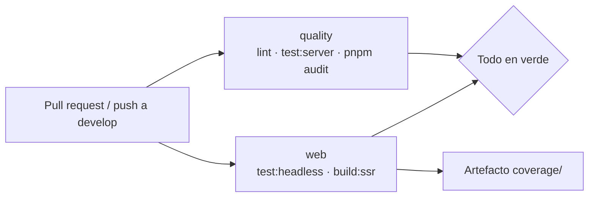

# CI y calidad de código (guía técnica)

Workflow de GitHub Actions: `.github/workflows/ci.yml`. Se ejecuta en cada pull request hacia `develop` o `main` y en cada
push a `develop`; un push nuevo a la misma rama cancela la ejecución anterior.



| Job | Qué ejecuta | Falla cuando |
|-----|-------------|--------------|
| `quality` | `pnpm run lint`, `pnpm run test:server`, `pnpm audit --audit-level high` | Hay un error de ESLint, un test del BFF falla o su cobertura baja del 85 %, o una dependencia tiene una vulnerabilidad alta o crítica |
| `web` | `pnpm run test:headless` (Karma + Chrome), `pnpm run build:ssr` | Un test falla, la cobertura baja del 85 % (`karma.conf.js`) o el build de producción no compila |

## ESLint (`eslint.config.js`)

Configuración *flat* con cuatro bloques:

| Archivos | Reglas |
|----------|--------|
| `src/**/*.ts` | `typescript-eslint` recomendado + `angular-eslint` recomendado (selectores con prefijo `app`) |
| `src/**/*.html` y plantillas en línea | `angular-eslint` de plantillas + **accesibilidad** (`label-has-associated-control`, `click-events-have-key-events`, `interactive-supports-focus`, …) |
| `*.spec.ts`, `src/testing` | Globales de Jasmine; `any` y `!` permitidos |
| `server.js`, `server/**`, `karma.conf.js` | `@eslint/js` recomendado, CommonJS en Node |

Ejecutar en local: `pnpm run lint`. Al introducir ESLint aparecieron 37 errores, todos reales y corregidos: 32 etiquetas de formulario
sin control asociado (ahora cada `<label>` tiene `for` y su control un `id`), 4 fondos de diálogo sin rol y un parámetro sin usar.

## Dependencias

`pnpm audit` pasó de 65 vulnerabilidades (1 crítica, 38 altas) a 1 moderada, solo de desarrollo (`minimatch` vía Karma). Se hizo con
`pnpm update`, alineando `@angular/router` y `@angular/ssr` con el resto de Angular (`^22.2.1`) y eliminando `toml`, que estaba
declarado dos veces y no se usaba. El job `quality` evita que vuelva a acumularse.

## Ejecutar todo antes de subir

```bash
pnpm install --frozen-lockfile
pnpm run lint
pnpm run test:server
CHROME_BIN="/Applications/Google Chrome.app/Contents/MacOS/Google Chrome" pnpm run test:headless   # macOS
pnpm run build:ssr
pnpm audit --audit-level high
```
