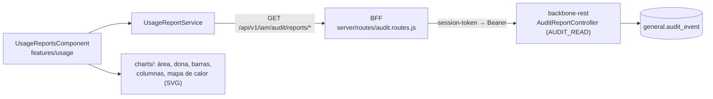

# Reportes de uso y accesos

Página **Uso y accesos** (`/usage`, menú *Herramientas*). Muestra cuántas personas usan la plataforma, cuándo se conectan y desde
qué tipo de cliente, aplicación por aplicación, para dimensionarla y decidir su alcance. Se construye con el registro de auditoría de
backbone-rest; son cifras **agregadas**: no se muestra ninguna persona, dirección ni token.

## Guía de usuario

### Quién puede verla

Quien tenga la feature `AUDIT_READ` en uno de sus roles. Si backbone está en modo `enforce` y falta, la página lleva a "Acceso
denegado". Pida a quien administra backbone que se la asigne (ver `docs/architecture/feature-authorization.md` en backbone-rest).

### Qué aplicaciones se ven

Con el permiso `AUDIT_READ` se ve **solo la aplicación de su sesión**; el filtro "Todas" equivale a esa aplicación y pedir otra la rechaza (403). Para ver todas las aplicaciones hace falta `AUDIT_READ_ALL` (o `Universal`).

### Cómo se usa

1. Elija el **periodo**: últimos 30 días, 90 días (por defecto), 6 meses, un año, o *Fechas a elegir*.
2. Si lo desea, elija una **aplicación**; por defecto se ven todas.
3. Pulse **Actualizar** (con los periodos predefinidos se actualiza solo).

El periodo no puede pasar de dos años y la fecha inicial debe ser anterior a la final; si no, aparece un aviso y puede reintentar.

### Qué muestra

| Bloque | Para qué sirve |
|--------|----------------|
| Tarjetas | Accesos exitosos, personas activas, aplicaciones con actividad y porcentaje de intentos fallidos |
| Accesos por semana | Si el uso crece o cae. Las barras magenta son intentos fallidos. Pase el puntero para ver cada semana |
| Quién se conecta | Navegadores, móviles y programas que llaman al API |
| Actividad por aplicación | Qué aplicaciones se usan y cuántos fallos tienen |
| Dimensionamiento | Accesos por semana con actividad, semana pico, hora pico y porcentaje de semanas con actividad |
| Accesos por hora / día y franja | Cuándo conectarse: sirve para elegir ventanas de mantenimiento |
| Accesos por mes | Tendencia mensual (el mes en curso puede estar incompleto) |
| Alcance por aplicación | Personas registradas frente a las que realmente acceden, y roles definidos |

Una tasa de fallos que crece, o una aplicación con muchas personas registradas y pocas activas, son las primeras señales a revisar.

### Aviso sobre los dispositivos

Si la mayoría de los eventos viene de "clientes de API", aparece un aviso: el servidor de Stratum debe reenviar el navegador de cada
persona (ya lo hace) y backbone debe confiar en él (`UMDC_AUDIT_TRUSTED_PROXIES`). Los eventos anteriores a ese ajuste no se
pueden corregir.

## Guía técnica

| Pieza | Archivo |
|-------|---------|
| Ruta lazy `/usage` y elemento de menú | `app.routes.ts`, `shared/layout/nav-items.ts` (icono `chart`) |
| Página, filtros y estados de carga/error | `features/usage/usage-reports.component.ts` |
| Servicio (7 llamadas en paralelo con `forkJoin`) | `core/services/usage-report.service.ts` |
| Modelos que reflejan los TO de backbone | `shared/models/usage-report.model.ts` |
| Gráficas (SVG propio, sin librerías) | `features/usage/charts/*.component.ts` |
| Funciones puras de dibujo y formato | `features/usage/charts/chart-utils.ts` |
| Rutas proxy del BFF (6) | `server/routes/audit.routes.js` |

Decisiones:

- **Sin librería de gráficos.** Cada gráfica es un componente SVG con señales; las matemáticas (escalas, arcos, colores) están en
  funciones puras con pruebas. El bundle de la página pesa ~35 kB.
- **Paleta validada** para daltonismo y contraste sobre el panel oscuro (`#0B1220`): cian, violeta, ámbar y magenta. El panel es
  oscuro en ambos temas.
- **Accesibilidad:** cada gráfica tiene `role="img"` y etiqueta; las columnas, el mapa de calor y la dona llevan `<title>` con el
  dato, y todos los controles tienen `label` asociado.
- Las horas y los días son los del servidor de backbone; no se guarda zona horaria con cada evento.
- 55 pruebas nuevas de Karma (utilidades, cada gráfica con sus interacciones, la página y el servicio) y 6 del BFF (rutas).

Contrato: los modelos se comprueban en compilación contra los tipos generados del OpenAPI de backbone (`pnpm run api:types`, `src/app/shared/api/backbone.d.ts`; `pnpm run api:sync` los refresca desde un backbone en marcha y la CI verifica que no haya deriva con `pnpm run api:check`).

Contrato de las respuestas: `docs/api/iam-audit-reports.md` en backbone-rest.

## Rendimiento

La aplicación usa detección de cambios **sin zona** (`provideZonelessChangeDetection`) y las tres gráficas inferiores (horas, mapa de calor y meses) se cargan con `@defer (on viewport)` al acercarse a la pantalla. Los componentes son `OnPush`; el estado que se muestra debe estar en *signals* u observables con `async`, no en campos que cambian en callbacks.
