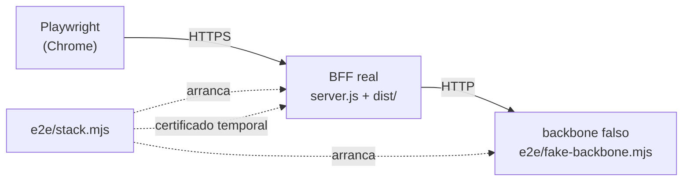

# Pruebas de extremo a extremo (guía técnica y de usuario)

Playwright maneja el **Chrome ya instalado** (no descarga navegadores) contra el BFF real, que sirve la aplicación compilada, y un
**backbone falso** con datos fijos. Verifican flujos completos que las pruebas unitarias no cubren: iniciar sesión, navegar y ver las
gráficas de uso.



## Ejecutarlas

```bash
pnpm run build:ssr      # el BFF sirve dist/
pnpm run test:e2e       # arranca el stack, ejecuta los flujos y lo detiene
```

Requiere Chrome y `openssl` (para el certificado temporal). Los puertos son 4443 (BFF) y 4199 (backbone falso); se cambian con
`E2E_PORT` y `E2E_BACKBONE_PORT`. Si falla una prueba, `test-results/` guarda la traza (`pnpm exec playwright show-trace ...`).

## Qué comprueban (`e2e/usage.spec.mjs`)

| Flujo | Resultado esperado |
|-------|--------------------|
| Contraseña errónea | Se queda en el login |
| Contraseña correcta | Llega al inicio y ve "Uso y accesos" en el menú |
| Página de uso | 4 tarjetas, las 6 gráficas y la tabla, con los datos del backbone falso |
| Pasar el puntero por la gráfica semanal | Aparece el tooltip "Semana del ..." |
| Cambiar el periodo | Se vuelven a pedir los reportes con las nuevas fechas |

## En la CI

El job `e2e` de `.github/workflows/ci.yml` compila la aplicación y ejecuta las pruebas con el Chrome del runner; si fallan sube las
trazas como artefacto. Para añadir un flujo, amplíe `e2e/fake-backbone.mjs` con las respuestas que necesite y escriba el `*.spec.mjs`.
