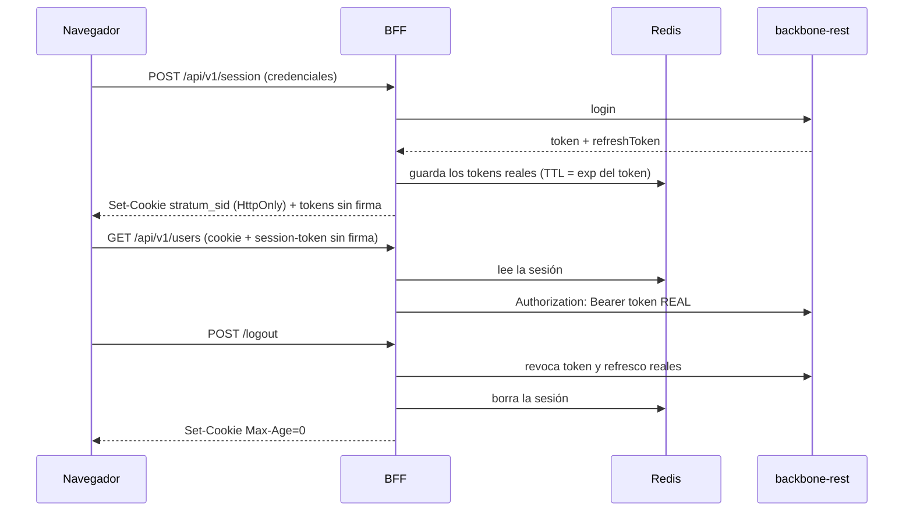

# Sesión en el servidor (cookie HttpOnly) — guía técnica y de usuario

Con `SESSION_COOKIE=true` el BFF guarda los tokens reales (sesión y refresco) **en el servidor** (Redis; en memoria si no hay Redis) y el
navegador solo recibe una cookie opaca `HttpOnly; SameSite=Strict; Secure`, más una copia **sin firma** del token para mostrar quién
es y cuándo caduca. Un script inyectado (XSS) ya no puede robar un token que sirva para llamar a backbone.

## Reglas
- **Apagado por defecto**: sin la variable todo funciona como antes. Una sesión antigua (token completo en `localStorage`, sin cookie)
  sigue funcionando; la cookie se ignora si no corresponde a una sesión.
- **CSRF**: una llamada que cambia datos y trae la cookie debe traer también la cabecera `session-token`; una página de otro sitio no
  puede añadirla, y `SameSite=Strict` bloquea además el envío de la cookie. Si falta, el BFF responde `403 {"error":"csrf"}`.
- **Refresco y renovación** usan el token de refresco real guardado; el navegador nunca lo envía firmado.
- Variables: `SESSION_COOKIE`, `SESSION_COOKIE_NAME` (`stratum_sid`), `SESSION_MAX_AGE_SECONDS` (28800, tope; la vida real es el `exp`).
- Con varias instancias del BFF hace falta Redis (`REDIS_URL`); en memoria cada instancia solo conoce sus sesiones.

## Cómo activarlo
1. Verifique que Redis está accesible. 2. Defina `SESSION_COOKIE=true` y reinicie. 3. Las personas inician sesión de nuevo; en
`localStorage` ya solo queda la copia sin firma. 4. Para volver atrás, quite la variable.

Pendiente de una segunda fase: dejar de guardar siquiera la copia sin firma en `localStorage` (la interfaz la usa para el usuario y la caducidad).
