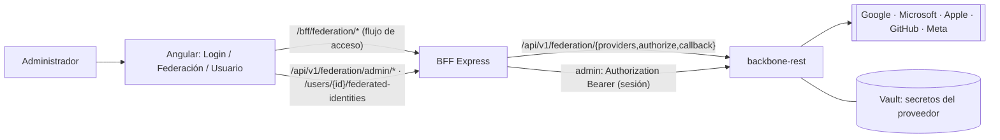
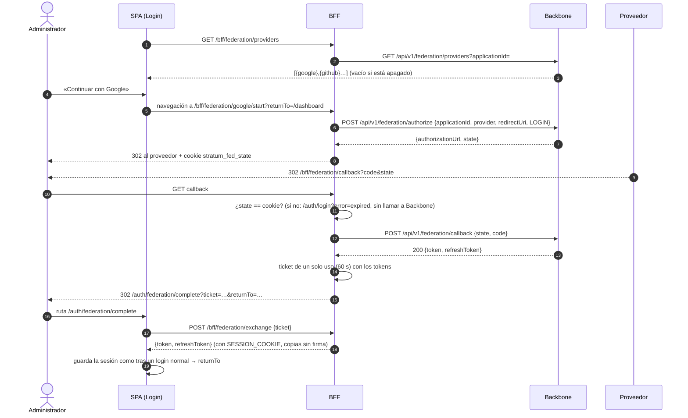

# Federación social en Stratum

> Estado: **implementado**, apagado por defecto (`FEDERATION_ENABLED=false`). Requisitos, diseño y plan: `backbone-rest/docs/requirements/social-federation.md`,
> `docs/architecture/social-federation.md` y `docs/plans/social-federation-implementation-plan.md`. Requiere el Backbone con la federación
> (migración `V10`, `com.umdc:persistence` 0.0.4) y la feature `FEDERATION_ADMIN` para administrar.

Stratum cumple **dos papeles**:

1. **Consumidor**: los administradores pueden entrar con Google, Microsoft, Apple, GitHub o Meta. Solo entran personas que **ya existen**
   en la aplicación de Stratum; el acceso por contraseña sigue igual.
2. **Consola de administración**: aquí se configuran los proveedores de cada aplicación y se ven/quitan las cuentas enlazadas de un usuario.

## Flujo de acceso

Por qué un ticket: Stratum guarda los tokens en el navegador (o, con `SESSION_COOKIE`, en el servidor). Los tokens **nunca** viajan en una URL: el
BFF los deja 60 segundos en el almacén de sesiones (Redis o memoria) bajo un identificador aleatorio de 256 bits y la SPA lo cambia una sola vez
(se borra al leerlo, también si ya expiró).

### Rutas del BFF (`server/routes/federation.routes.js`, bajo `/bff/federation`)

Van **fuera de `/api`** a propósito: las redirecciones del proveedor son navegaciones del navegador y el flujo tiene su propia cookie de estado,
así que no les aplican la regla CSRF de la cookie de sesión ni el límite de la API.

| Ruta | Método | Qué hace |
|---|---|---|
| `/providers` | GET | `{enabled, providers[]}`; apagado → `{enabled:false, providers:[]}` |
| `/:provider/start?returnTo=` | GET | Valida `returnTo`, pide `authorize`, guarda la cookie y redirige al proveedor |
| `/callback` | GET / POST | Verifica el `state` contra la cookie y llama a `callback`; **POST** para Apple (`form_post`) |
| `/exchange` | POST | Cambia el ticket por los tokens (un solo uso) |

Reglas: cookie `stratum_fed_state` `HttpOnly; Path=/bff/federation; Max-Age=600`, `SameSite=Lax` (**Apple**: `None; Secure`); `returnTo` solo ruta del
mismo sitio (una `/` inicial, sin `\` ni saltos de línea); errores de Backbone → `/auth/login?error=<código>` (`denied`, `expired`, `failed`,
`not_registered`, `not_allowed`, `not_linked`, `conflict`, `unavailable`, `rate_limited`); nunca se registran `code`, `state` ni tokens; con la función
apagada todo (salvo `/providers`) responde 404.

### Administración (rutas proxy del BFF)

| Ruta | Va a Backbone |
|---|---|
| `GET/POST /api/v1/federation/admin/providers` | `/api/v1/federation/admin/providers` |
| `GET/PUT/DELETE /api/v1/federation/admin/providers/:id` | ídem con el id (UUID validado) |
| `GET /api/v1/users/:userId/federated-identities` | ídem |
| `DELETE /api/v1/users/:userId/federated-identities/:identityId` | ídem |

Solo estas rutas: `authorize` y `callback` de Backbone **no** se exponen al navegador. Backbone decide con la sesión del administrador
(`FEDERATION_ADMIN`, `READ_USER`/`WRITE_USER`).

## Pantalla «Federación» (menú Herramientas → Federación)

Se elige la aplicación y se ve su lista de proveedores con interruptor **Activo**, **Editar** y **Quitar** (con confirmación; Backbone responde 409 si hay
usuarios enlazados).

| Campo | Regla |
|---|---|
| Proveedor | `google`, `microsoft`, `apple`, `github`, `meta`; uno por aplicación (no se cambia al editar) |
| Client ID | texto |
| **Referencia del secreto** | nombre de la variable de entorno (Vault) con el secreto; **solo letras, números y `_ . : - /`**: el valor nunca se muestra ni se envía |
| URIs de retorno | una por línea; HTTPS y **exactas** (sin `*` ni `#`); p. ej. `https://<host>/bff/federation/callback` |
| Dominios de correo permitidos | separados por comas; vacío = cualquiera |
| Confiar en el correo verificado | enlace automático por correo; **apagado por defecto en Meta** |
| Activo | interruptor de apagado inmediato (el acceso por contraseña no se afecta) |

## Cuentas enlazadas de un usuario

En **Aplicaciones → Usuarios → Editar usuario**, la tarjeta **Cuentas enlazadas** lista las cuentas externas del usuario y permite **Desenlazar**
(con confirmación). Desenlazar siempre es posible: todo usuario conserva su contraseña.

## Configuración del BFF

| Variable | Por defecto | Nota |
|---|---|---|
| `FEDERATION_ENABLED` | `false` | Interruptor de la función |
| `FEDERATION_APPLICATION_ID` | — | **Obligatoria** si está activa: la aplicación en la que Stratum registra a las personas (el mismo id de `API.APPLICATION.ID`) |
| `FEDERATION_CALLBACK_URL` | — | **Obligatoria** si está activa; exactamente el `redirectUri` del ajuste en Backbone: `https://<host>/bff/federation/callback` |

Si la aplicación de Stratum exige cliente gestionado (`SESSION_CLIENT_REQUIRED_APPLICATIONS` en Backbone), el login por contraseña de Stratum ya no
funcionaría tampoco: federación hereda la misma condición.

## Pruebas

BFF (`node --test`): `federation.test.js` (flujo completo contra un Backbone simulado, ticket de un solo uso, `state` ajeno, cada código de error,
Apple POST, `returnTo` hostil, rutas de administración y de identidades, UUID inválidos, endpoints públicos no expuestos) y `federation-off.test.js`.
Angular (Karma/Jasmine): servicio, login (botones, error, fallo del BFF), `federation-complete`, pantalla de proveedores, cuentas enlazadas.
Cobertura ≥ 85 %; se ejecutan **todas** las suites (`pnpm run test:all`) antes de cada PR.
