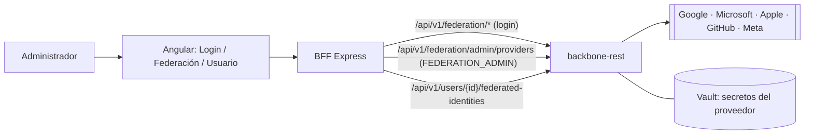
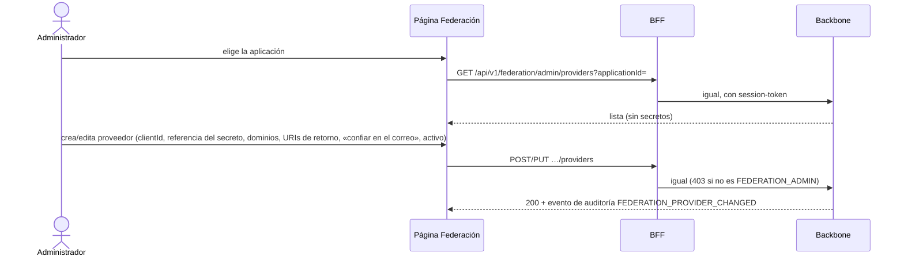

# Federación social en Stratum (diseño)

> Estado: **diseño** (17 nov 2026), sin implementar. Requisitos, diseño de Backbone y plan por fases: `backbone-rest/docs/requirements/social-federation.md`,
> `docs/architecture/social-federation.md` y `docs/plans/social-federation-implementation-plan.md`.

Stratum cumple **dos papeles**:

1. **Consumidor**: los administradores pueden entrar con Google, Microsoft, Apple, GitHub o Meta. Es el mismo flujo que Iris
   (el BFF habla con Backbone, que valida al proveedor y entrega el mismo par de tokens `session-token`/refresh).
2. **Consola de administración**: aquí se configuran los proveedores de cada aplicación y se ven/quitan las cuentas enlazadas de un usuario.

## Login (BFF)

Rutas `/auth/federation/{providers,:provider/start,callback}` con las mismas reglas que Iris: cookie `fed_state` (`HttpOnly; Secure;
SameSite=Lax; Max-Age=600`), `returnTo` solo relativo y permitido, un `state` distinto de la cookie no llama a Backbone, errores
mapeados a `/login?error=<código>` (`denied`, `expired`, `failed`, `not_registered`, `not_allowed`, `unavailable`, `rate_limited`),
`Cache-Control: no-store`, sin registrar `code`/`state`/tokens. Solo entra quien **ya existe** en Backbone; la sesión resultante pasa por
el mismo guardado de sesión en Redis que el login por contraseña (`docs/14-sesion-en-servidor.md`).

## Pantalla «Federación» (menú Administración)

| Campo | Regla |
|---|---|
| Proveedor | `google`, `microsoft`, `apple`, `github`, `meta`; uno por aplicación |
| Client ID | texto; visible |
| **Referencia del secreto** | nombre de la clave en Vault/entorno; **el valor nunca se muestra ni se envía**; lo instala un operador |
| URIs de retorno | lista exacta (una por entorno) |
| Dominios de correo permitidos | opcional; vacío = cualquiera |
| Confiar en el correo | habilita el enlace automático por correo verificado; **apagado por defecto en Meta** |
| Activo | interruptor de apagado inmediato (el login por contraseña no se afecta) |

Ficha del usuario: pestaña **Cuentas enlazadas** (proveedor, correo, último acceso) con **Desenlazar** y confirmación; `409` si es su único
medio de acceso (se muestra el motivo del `Warning`). La pantalla y sus botones se ocultan sin `FEDERATION_ADMIN` / `WRITE_USER`.

## Tareas y pruebas

BFF: rutas de login y proxys de administración (lista blanca de campos, ids UUID, CSRF en escrituras). Angular: servicio con signals, página,
formulario validado, pestaña en el usuario. Pruebas: BFF (`server/test`), Karma/Jasmine de componentes y servicio, e2e Playwright con
Backbone simulado; cobertura ≥ 85 %; se ejecutan **todas** las suites antes de cada PR. Depende de que Backbone publique los endpoints
de administración (fase 1 del plan).
